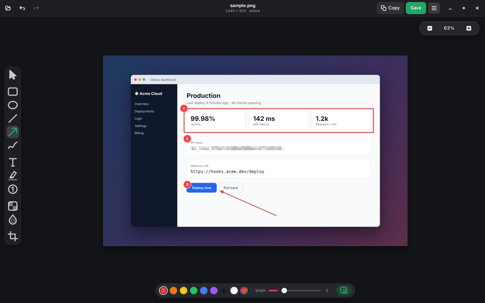
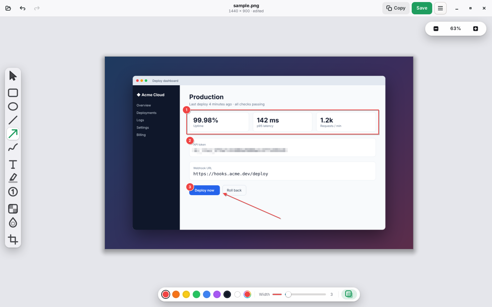
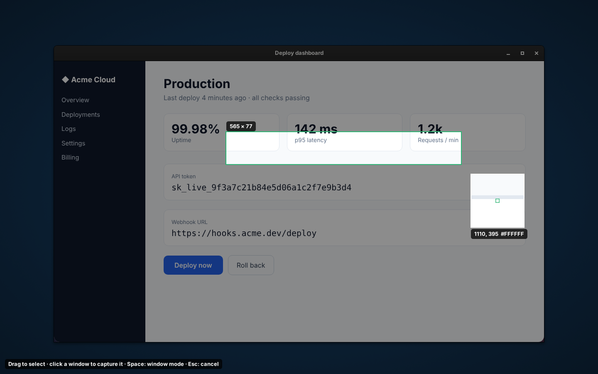
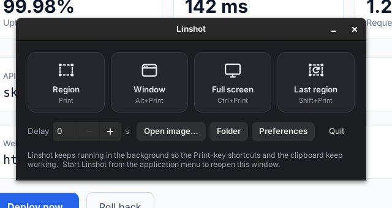
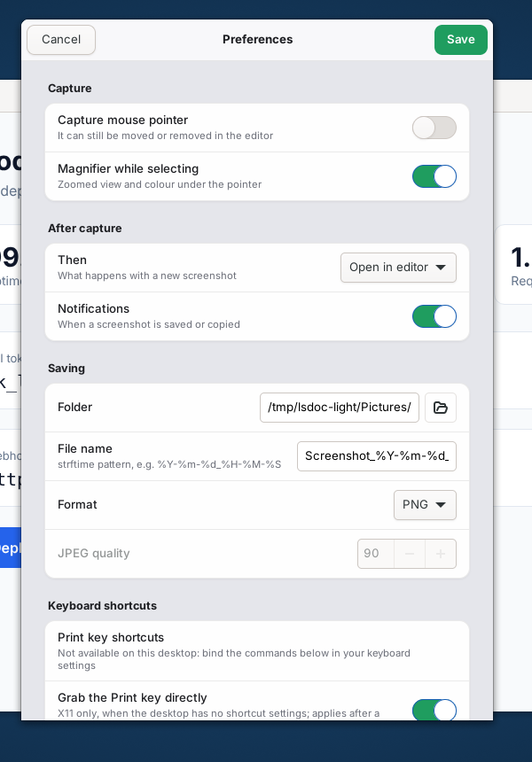
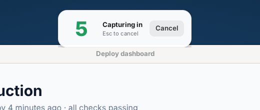

<p align="center">
  
</p>

<h1 align="center">Linshot</h1>

A screenshot and annotation tool for Linux, written in Rust + GTK 4.
Works on **X11** and **Wayland** (GNOME, KDE Plasma, Cinnamon, and wlroots compositors such as Wayfire, Sway, Hyprland, labwc).

Website: https://adityatelange.github.io/linshot/




| Region selection | Launcher |
|---|---|
|  |  |
| **Preferences** | **Delayed capture** |
|  |  |

## Features

- **Capture modes:** region, window, active window, full screen (all monitors), last region, delayed capture
- **Region selector:** frozen-screen overlay, crosshair, pixel magnifier with colour readout, size label,
  click a window to snap to it (X11), Space toggles window mode, Esc / right-click cancels
- **Editor:** rectangle, ellipse, line, arrow, freehand, text, highlighter, pixelate, blur,
  numbered step counters, crop; select/move/delete, per-shape colour/fill/width/font/shadow,
  undo/redo, zoom
- **Mouse pointer** captured as a movable object in the editor (X11, wlroots), or painted in (optional)
- **Output:** save (PNG/JPEG, filename pattern), save as, copy to clipboard, print, open existing images
- **Tray icon** (StatusNotifierItem), single instance, notifications, autostart option

## Install

```bash
sudo apt install ./dist/linshot_0.1.0_amd64.deb
```

Requires GTK ≥ 4.6 and glibc ≥ 2.35: Ubuntu 22.04+, Debian 12+, Linux Mint 21+, Pop!_OS 22.04+,
or newer derivatives. Use the `.deb` built for the oldest release you run (the 22.04 build also
installs on 24.04 and Debian 12/13).

## Keyboard shortcuts

| Action        | X11 (built-in) | Command to bind on Wayland |
|---------------|----------------|----------------------------|
| Region        | Print          | `linshot region`           |
| Window        | Alt+Print      | `linshot window`           |
| Full screen   | Ctrl+Print     | `linshot full`             |
| Last region   | Shift+Print    | `linshot last`             |

Wayland does not allow apps to grab global keys. On **Wayfire** (via `wayfire.ini`), **Cinnamon**,
**GNOME** (also Budgie, Unity) and **Xfce** (via `xfconf-query`), Linshot offers to
register these shortcuts in the desktop's keyboard settings on first start (also in Preferences →
Shortcuts) and frees Print from the built-in screenshot tool. Linshot then starts at login and
re-applies its shortcuts if the session regenerates its config. On other desktops add them as custom
shortcuts yourself; Preferences shows the lines to add for Sway, Hyprland, niri, river and labwc, and
where to look on KDE Plasma, LXQt, MATE and COSMIC. If your desktop already owns the Print key on
X11, either free it or bind the commands the same way.

Editor keys: `S` select, `R` rect, `E` ellipse, `L` line, `A` arrow, `F` freehand, `T` text,
`H` highlight, `O` pixelate, `B` blur, `I` counter, `C` crop (Enter applies), `Del` delete,
`Ctrl+Z/Y` undo/redo, `Ctrl+S` save, `Ctrl+Shift+S` save as, `Ctrl+C` copy, `Ctrl+P` print,
`Ctrl+0` fit, `Ctrl+1` 100 %, `Ctrl+wheel` zoom, `Shift` while drawing constrains.

## Command line

```
linshot [region|window|active|full|last|open FILE...|settings|quit] [-d SECONDS] [-o FILE] [-c|-s|-e] [--tray]
```

`-o FILE` saves straight to a file, `-c` copies to the clipboard, `-s` saves to the screenshots folder.

## How capture works

- **X11:** grabs the root window directly; window list from `_NET_CLIENT_LIST_STACKING`.
- **Wayland, wlroots compositors (Wayfire, Sway, Hyprland, labwc, river):** native `wlr-screencopy`, no helper tools.
- **Window detection on Wayland:** Wayfire IPC (`ipc` + `ipc-rules` plugins), `swaymsg`, `hyprctl`.
- **Wayland, other desktops:** Cinnamon's screenshot API, then `org.freedesktop.portal.Screenshot`, then `grim`,
  `spectacle` or `gnome-screenshot`. Window capture uses the portal's picker, or Linshot's own overlay when there is none.

## Build

```bash
sudo apt install libgtk-4-dev libdbus-1-dev pkg-config dpkg-dev
curl https://sh.rustup.rs -sSf | sh   # Rust ≥ 1.86; distro cargo is too old on 22.04/Debian 12
packaging/build-deb.sh          # -> dist/linshot_<version>_<arch>.deb
```

The `.deb` targets the architecture it is built on and every release at least as new as the build
host. CI builds amd64 and arm64 packages on Ubuntu 22.04, which install on Ubuntu 22.04+ and
Debian 12+.

## License

Copyright (C) 2026 Aditya Telange

Linshot is free software: you can redistribute it and/or modify it under the terms of the
GNU General Public License as published by the Free Software Foundation, either version 3 of
the License, or (at your option) any later version. See [LICENSE](LICENSE).

The `.deb` packages also include the licenses of the bundled Rust crates in
`/usr/share/doc/linshot/THIRD-PARTY-LICENSES.gz`.
